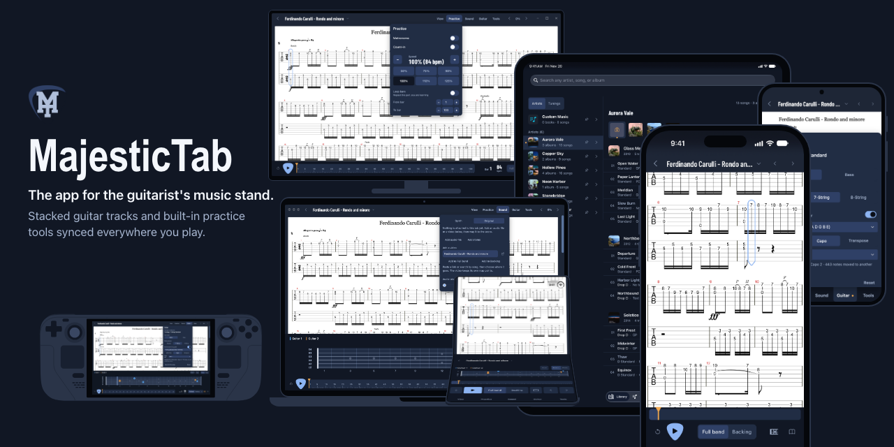
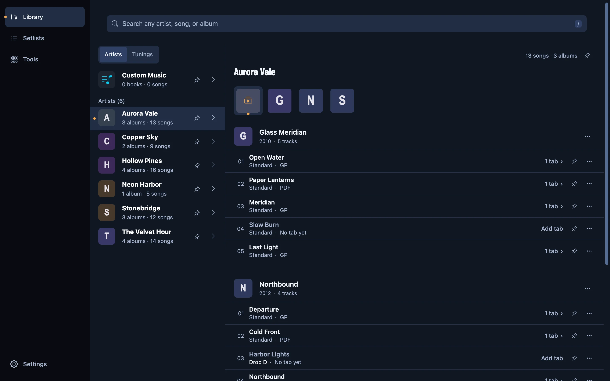
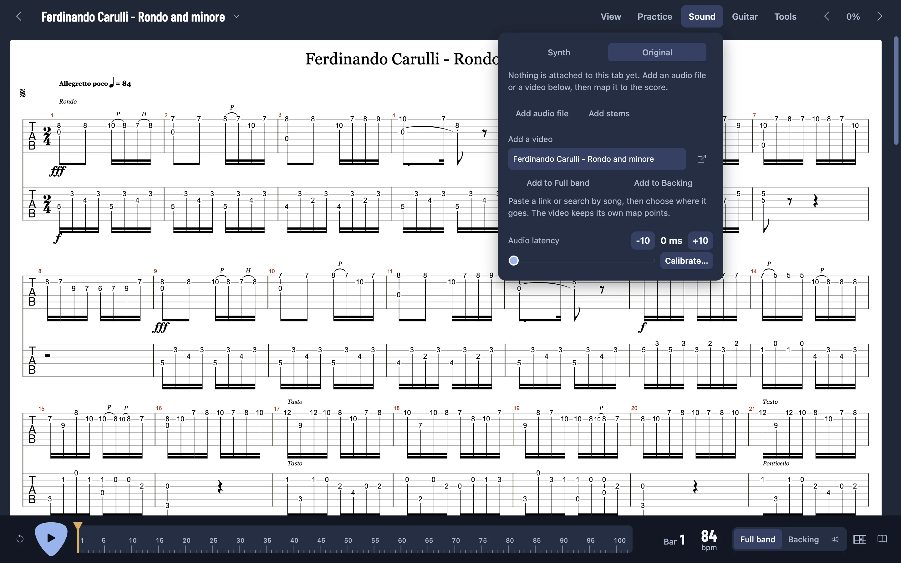
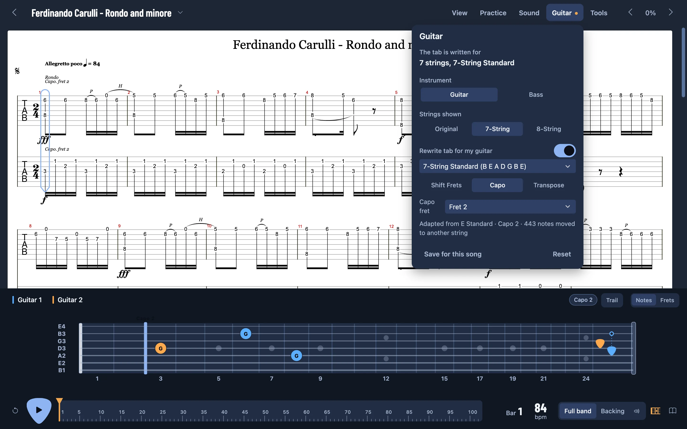
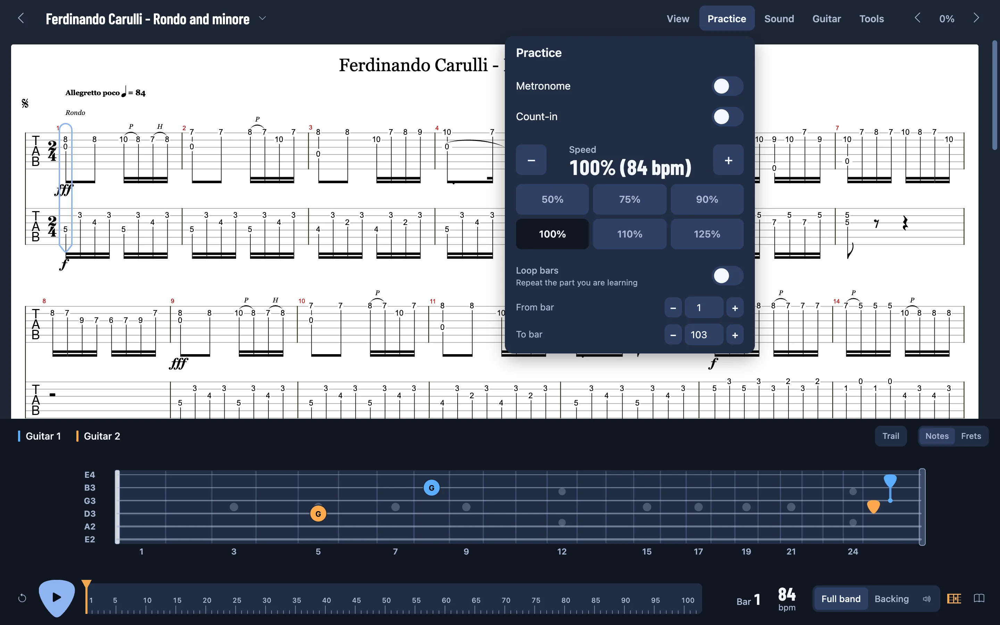

<div align="center">

# MajesticTab

[](LICENSE)
[](https://github.com/cgarst/MajesticTab/releases/latest)
[](https://github.com/cgarst/MajesticTab/releases)
[](#download)

[**Website**](https://majestictab.zathu.net/) · [**Download**](#download) · [**Features**](#features) · [**Contributing**](CONTRIBUTING.md) · [**Report an issue**](https://github.com/cgarst/MajesticTab/issues)

</div>

MajesticTab is a guitar tab reader and practice app. It opens Guitar Pro files (`.gp`, `.gp3` to `.gp5`, `.gpx`), PDFs, and text tabs, and works offline. It organizes your tabs by song, plays them along with the original recording or a SoundFont synth. It can rewrite them to fit a different guitar's tuning or string count, and lets your friends follow along over the local network.

## Download

<p align="center">
  <a href="https://apps.apple.com/us/app/majestictab/id6833538312"></a>&nbsp;&nbsp;<a href="https://apps.microsoft.com/detail/9p7mb2c84cfv?referrer=appbadge"></a>&nbsp;&nbsp;<a href="https://play.google.com/store/apps/details?id=net.zathu.majestictab"></a>
</p>

Direct installers and packages are published on [GitHub Releases](https://github.com/cgarst/MajesticTab/releases/latest):

| Platform | Store and packages | Direct downloads |
| --- | --- | --- |
| **iPhone and iPad** | [App Store](https://apps.apple.com/us/app/majestictab/id6833538312) (universal purchase with Mac) | [Build it yourself](CONTRIBUTING.md#building-native-packages) or use the [web app](https://majestictab.zathu.net/app) (fewer features) |
| **macOS** | [Mac App Store](https://apps.apple.com/us/app/majestictab/id6833538312) | [Apple Silicon `.dmg`](https://github.com/cgarst/MajesticTab/releases/latest) · [Intel `.dmg`](https://github.com/cgarst/MajesticTab/releases/latest) |
| **Windows** | [Microsoft Store](https://apps.microsoft.com/detail/9p7mb2c84cfv) | [Installer `x86_64` (`.exe`)](https://github.com/cgarst/MajesticTab/releases/latest) · [Installer `ARM64` (`.exe`)](https://github.com/cgarst/MajesticTab/releases/latest) |
| **Android** | [Google Play](https://play.google.com/store/apps/details?id=net.zathu.majestictab) · F-Droid (coming soon) | [Android `.apk`](https://github.com/cgarst/MajesticTab/releases/latest) |
| **Linux and Steam Deck** | [Flatpak repository](#install-from-the-flatpak-repository) | [Flatpak `x86_64`](https://github.com/cgarst/MajesticTab/releases/latest) · [Flatpak `ARM64`](https://github.com/cgarst/MajesticTab/releases/latest) · [Steam Deck art (`.zip`)](docs/img/steam/steam_deck_artwork.zip) |

> [!NOTE]
> MajesticTab is free on the Microsoft Store, Google Play, Linux, and direct downloads. On the Apple App Store, a one-time purchase covers iPhone, iPad, and Mac to support App Store distribution costs.

## Features

### Library

MajesticTab organizes your tabs by artist, album, and song.

- Link several Guitar Pro, PDF, text tabs, audio tracks, stems, and/or YouTube videos to one song.
- Group your library by tuning (Standard, Drop D, D Standard, DADGAD, 7-string, 8-string, or custom).
- Build setlists for rehearsals and gigs.
- Keep files on your device, or connect Google Drive, S3, WebDAV, or iCloud to sync devices and save archives of your library.



### Play along with the original recording

MajesticTab will automatically create a rough mapping of Guitar Pro tabs to the provided audio or YouTube video to allow auto-scrolling. You can also attach a separate backing track (e.g. no guitar) and switch between it and the original.

To precisely map a YouTube video or a local audio file, select **Not mapped** and then **Tap along**, and tap each bar as you hear it. The cursor, metronome, and count-in follow the recording through tempo changes and drift. Staff-based text tabs with a linked MIDI file are aligned to it automatically, and scroll along as it plays. Other PDF and text tabs aren't mapped to a recording automatically, but you can tap along to a recording to map their pages or lines.

Without a recording, the built-in SoundFont synth plays Guitar Pro tabs offline. It allows per-track mixing, custom `.sf2` and `.sf3` SoundFonts, speed adjustment, and looping.



### Fit a tab to your guitar

Show a Guitar Pro tab on 6, 7, or 8 strings, or rewrite the frets for your guitar, with a capo or transposed for tunings. Every note keeps its pitch. Changes apply to the open song and reset when you close it. You can also save them for that song or as your default guitar preference.



### Reader

The reader's controls are in five menus: **View**, **Practice**, **Tracks**, **Guitar**, and **Tools**.

- Show several guitar parts together in vertical scroll, horizontal scroll, or multi-page book layout. Automatically strips empty staves, as well as drums, bass, keys, and vocals parts. Export what you see as PDF to take the consolidated view somewhere else.
- See the notes of the current beat light up on a virtual fretboard in per-track colors, with left-handed and upside down options.
- Open the chord library, scale reference, circle of fifths, chromatic microphone tuner, and metronome from the score.
- Pick from nine themes with light or dark sheets.
- Turn pages or control playback with a Bluetooth foot pedal (AirTurn, PageFlip, Donner) or a game controller (Xbox, PlayStation, Steam Deck).



### Jam

Host a Jam session on your local network. Others join from their own phone, tablet, or laptop by scanning a QR code. Playback position and audio stay in sync across devices, and the host can assign each guitarist a track.

## Running from source

The frontend in `src/` runs directly in any modern browser with no build step:

```bash
./run_web.sh
```

Then open `http://localhost:8000/src/`.

To run the desktop app in development mode, install [Node.js, Rust, and the Tauri v2 prerequisites](https://v2.tauri.app/start/prerequisites/), then run:

```bash
./run.sh
```

[CONTRIBUTING.md](CONTRIBUTING.md) covers packaging for `macos`, `windows`, `linux`, `android`, and `ios`, PDF optimization tips, and the project architecture.

## Acknowledgments

- [AlphaTab](https://github.com/CoderLine/alphaTab) for Guitar Pro rendering and playback support
- [chords-db](https://github.com/tombatossals/chords-db) by David Rubert for guitar chord data (MIT License)
- [Chord Options](https://chordoptions.com/shapes/) for the default movable shape of each chord type (the root position fret patterns only; CC BY 4.0, and the common shapes it lists come from chords-db)
- [PitchCraft](https://github.com/indjoov/pitchcraft) for chromatic tuner and pitch detection implementation
- [The Minimal Metronome](https://github.com/ZaneH/metronome) by Zane Helton for the metronome's tempo tapper, time signatures, swing-arm display and keyboard controls
- [Classtab](https://www.classtab.org/) for the classical guitar tabs and MIDI files in the Classical tab browser; the archive is downloaded by the user and never shipped
- [PDF.js](https://mozilla.github.io/pdf.js/) for PDF rendering
- [Bootstrap](https://getbootstrap.com/) for the layout, form and button styles in `src/base.css` (a cut-down adaptation of its stylesheet), and [Bootstrap Icons](https://icons.getbootstrap.com/) for the icons
- [jsPDF](https://github.com/parallax/jsPDF) for export functionality
- [SoundTouchJS](https://github.com/cutterbl/SoundTouchJS) (`@soundtouchjs/audio-worklet`, MPL-2.0, used unmodified) for slow-down practice that keeps the pitch of a local audio file

## License

MajesticTab is licensed under the [Mozilla Public License 2.0](LICENSE).
