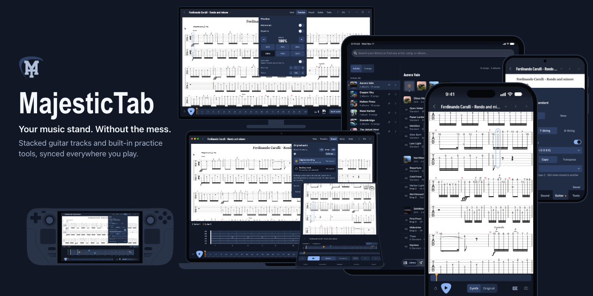
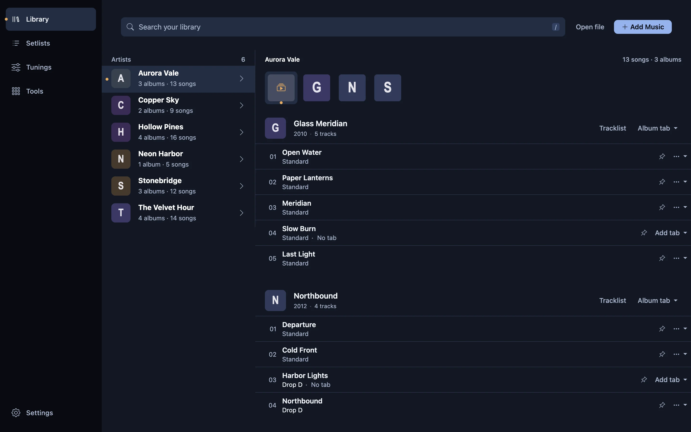
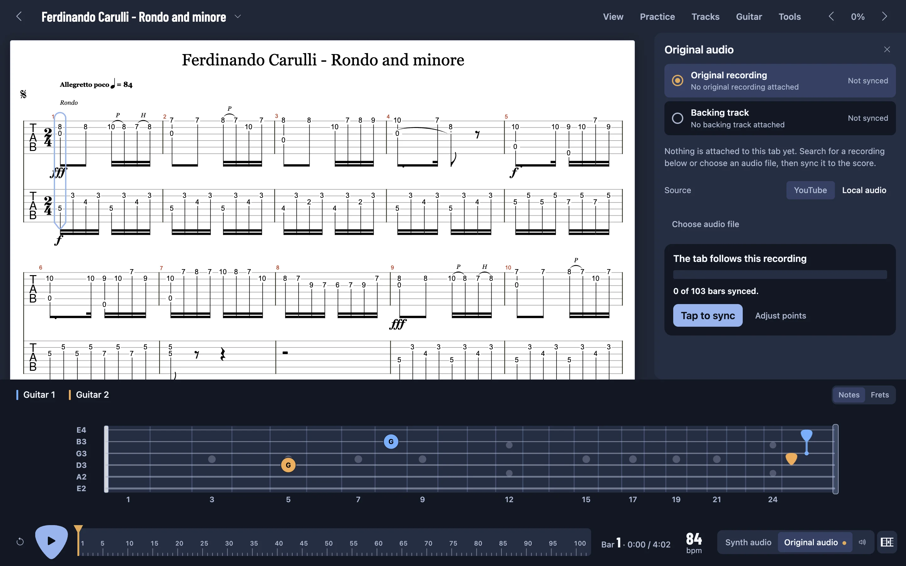
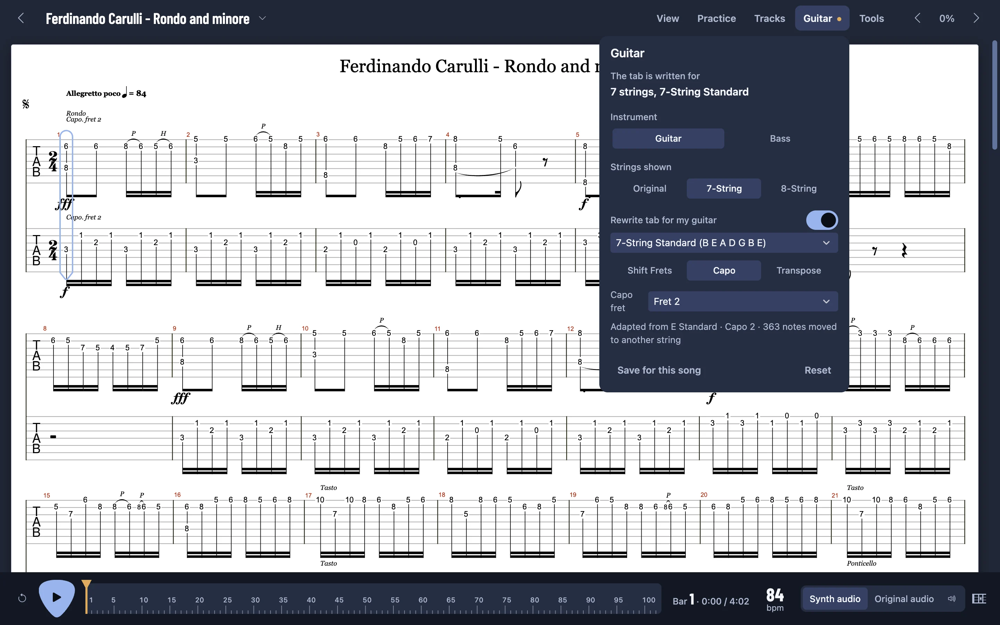
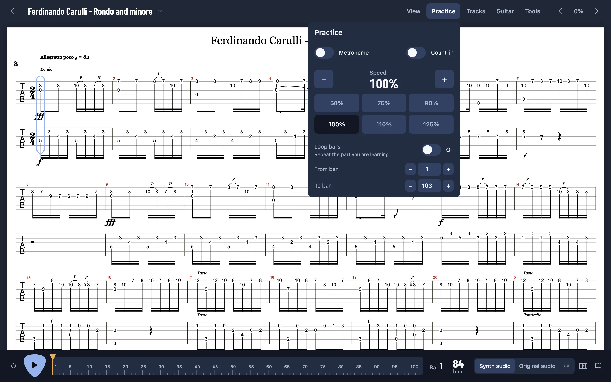

<div align="center">

# MajesticTab

**Your music stand. Without the mess.**

Bring all your guitar tabs into one library, fitted to your guitar and synced to the original recording.

[](LICENSE)
[](https://github.com/cgarst/MajesticTab/releases/latest)
[](#download)

[**Website**](https://majestictab.zathu.net/) · [**Download**](#download) · [**Features**](#features) · [**Keyboard shortcuts**](#keyboard-shortcuts) · [**Contributing**](CONTRIBUTING.md) · [**Report an issue**](https://github.com/cgarst/MajesticTab/issues)

</div>

---

MajesticTab is a native, offline-first guitar tab reader and practice app for Guitar Pro files (`.gp`, `.gp3` to `.gp5`, `.gpx`), PDFs, and text tabs. It keeps your scores organized in a song-centric library, plays multi-track tabs with a built-in SoundFont synth or synced to the original recording, rewrites tabs to fit your guitar's strings and tuning, and lets your whole band jam on the same bar over the local network.

There are **no subscriptions, no ads, no accounts, and no locked features**.

---

## Download

<p align="center">
  <a href="https://apps.apple.com/us/app/majestictab/id6833538312"></a>&nbsp;&nbsp;<a href="https://apps.apple.com/us/app/majestictab/id6833538312"></a>&nbsp;&nbsp;<a href="https://play.google.com/store/apps/details?id=net.zathu.majestictab"></a>&nbsp;&nbsp;<a href="https://apps.microsoft.com/detail/9p7mb2c84cfv?referrer=appbadge"></a>
</p>

Direct installers and packages are published on [GitHub Releases](https://github.com/cgarst/MajesticTab/releases/latest):

| Platform | Store and packages | Direct downloads |
| --- | --- | --- |
| **iPhone and iPad** | [App Store](https://apps.apple.com/us/app/majestictab/id6833538312) (universal purchase with Mac) | [iOS `.ipa`](https://github.com/cgarst/MajesticTab/releases/latest) and [SideStore / AltStore source](https://github.com/cgarst/MajesticTab/releases/latest/download/source.json) |
| **macOS** | [Mac App Store](https://apps.apple.com/us/app/majestictab/id6833538312) | [Apple Silicon `.dmg`](https://github.com/cgarst/MajesticTab/releases/latest) · [Intel `.dmg`](https://github.com/cgarst/MajesticTab/releases/latest) |
| **Windows** | [Microsoft Store](https://apps.microsoft.com/detail/9p7mb2c84cfv) | [Installer `x86_64` (`.exe`)](https://github.com/cgarst/MajesticTab/releases/latest) · [Installer `ARM64` (`.exe`)](https://github.com/cgarst/MajesticTab/releases/latest) |
| **Android** | [Google Play](https://play.google.com/store/apps/details?id=net.zathu.majestictab) · F-Droid (coming soon) | [Android `.apk`](https://github.com/cgarst/MajesticTab/releases/latest) |
| **Linux and Steam Deck** | Flatpak bundles | [Flatpak `x86_64`](https://github.com/cgarst/MajesticTab/releases/latest) · [Flatpak `ARM64`](https://github.com/cgarst/MajesticTab/releases/latest) · [Steam Deck art (`.zip`)](docs/img/steam/steam_deck_artwork.zip) |

> [!NOTE]
> MajesticTab is free and open source on the Microsoft Store, Google Play, Linux, and direct desktop and Android downloads. On the Apple App Store, a single one-time purchase unlocks the app across iPhone, iPad, and Mac to help cover App Store distribution costs and support ongoing development.

---

## Features

### A library, not a folder of files

Most tab apps hand you a list of files. MajesticTab builds a library around the songs you play, fetching artist discographies, album covers, release years, and track orders so your tabs match the real releases.

- **Artists, albums, and tracklists:** Link multiple Guitar Pro, PDF, and text tabs to each song, pin songs you are practicing, and reopen the last tab you used.
- **Browse by tuning:** Group your library by Standard, Drop D, D Standard, DADGAD, 7-string, 8-string, or custom tunings so you can play a set without retuning between songs.
- **Setlists and collections:** Build rehearsal and gig order setlists or group exercises and playlists into custom collections.
- **Your tabs, wherever they live:** Keep files offline on your device, search tab sites directly inside the app with metadata filled in automatically, or connect your own **Google Drive, S3, WebDAV, or iCloud** for cross-device sync and `.mtbackup` full-library archives.



### Play along with the original recording

Sync any tab to the record you learned it from, and the playhead follows the music.

- **Tap to sync:** Link a YouTube video or a local audio file on your device, press **Tap to sync**, and tap each bar as you hear it. The cursor, metronome, and count-in follow the recording through tempo changes and live drift.
- **Fine-tune any section:** Re-tap a range of bars, nudge individual sync points, snap a tap to the nearest audio transient, or attach a separate backing track and switch between the original and backing audio.
- **Built-in SoundFont synth:** Play Guitar Pro tabs offline with per-track mixing, solo/mute controls, one-click "No guitars" (or "No bass") backing mode, custom `.sf2` / `.sf3` SoundFonts, speed control from 50% to 125% (pitch-preserved on local audio too), bar looping, and a 10-second rewind.



### Make any tab fit your guitar

Show a Guitar Pro tab on 6, 7, or 8 strings, or rewrite the frets to match the guitar in your hands—with a capo or transposed—while every note keeps its pitch. Changes apply to the open song and reset when you close it, or can be saved for that song or as your default guitar.



### One reader, five controls

All reader controls live under five menus—**View**, **Practice**, **Tracks**, **Guitar**, and **Tools**—so the score stays front and center.

- **Multi-track reading:** Stack multiple guitar parts together in continuous scroll, single-page, or two-page book spreads while drums, bass, keys, and vocals stay out of the way.
- **PDF optimizer and bulk export:** Condense multi-track Guitar Pro PDF exports by stripping empty staves and margins, or export your entire library as printable PDFs in a single ZIP archive.
- **Virtual fretboard:** Watch the notes of the current beat light up with per-track colors and a left-handed flip option.
- **Built-in practice tools:** Open the chord library (adapted to any tuning and capo), scale reference, circle of fifths, chromatic microphone tuner, and visual metronome one tap from the score.
- **Themes and hands-free control:** Choose from nine app themes with light or dark sheets, and turn pages or control playback with a Bluetooth foot pedal (AirTurn, PageFlip, Donner) or a game controller (Xbox, PlayStation, Steam Deck).



### Jam on the same page, in the same room

Host a Jam session on your local network and let everyone else in the room join from their own phone, tablet, or laptop with a QR code. Playback position and synced audio stay locked together across devices, and the host can assign each guitarist their own track.

---

## Keyboard shortcuts

Shortcuts work while a score is open and no text field is focused. Game controller diagrams and bindings are available inside the app under **Settings → Controls**.

| Key | Action |
| --- | --- |
| `→`, `↓`, `Page Down` | Next page (or scroll down in continuous mode) |
| `←`, `↑`, `Page Up` | Previous page (or scroll up in continuous mode) |
| `Space` | Play or pause audio (advances the page when no audio is loaded) |
| `B` | Rewind audio by 10 seconds |
| `G` | Toggle the SoundFont between full band and no guitars (no bass in bass mode) |
| `M` | Toggle the metronome |
| `I` | Toggle the count-in |
| `,`, `.` | Slow down or speed up playback by 5% |
| `[`, `]` | Previous or next tab in the open setlist |
| `F` | Toggle the fretboard dock |
| `T` | Toggle the chromatic tuner |
| `C` | Toggle the chord library |
| `S` | Toggle the scales reference |
| `O` | Toggle the circle of fifths |
| `R` | Toggle reading mode (hide the top bar and playback dock) |
| `Ctrl + Wheel` / `Pinch` | Zoom score (50%–150%) |
| `Alt + Enter` | Toggle fullscreen (Windows and Linux) |
| `Cmd + [` / `Alt + ←` / `Mouse 4` | Back |
| `Cmd + ]` / `Alt + →` / `Mouse 5` | Forward |
| `Esc` | Close the open dialog, menu, or panel |

---

## Running from source

The frontend in `src/` runs directly in any modern browser with no build step:

```bash
./run_web.sh
```

Then open `http://localhost:8000/src/`.

To launch the native desktop app in development mode (requires [Node.js, Rust, and Tauri v2 platform prerequisites](https://v2.tauri.app/start/prerequisites/)):

```bash
./run.sh
```

For platform packaging (`macos`, `windows`, `linux`, `android`, `ios`), PDF optimization tips, and project architecture, see [CONTRIBUTING.md](CONTRIBUTING.md).

---

## Acknowledgments

- [AlphaTab](https://github.com/CoderLine/alphaTab) for Guitar Pro rendering and playback support
- [chords-db](https://github.com/tombatossals/chords-db) by David Rubert for guitar chord data (MIT License)
- [Chord Options](https://chordoptions.com/shapes/) for the default movable shape of each chord type (the root position fret patterns only; CC BY 4.0, and the common shapes it lists come from chords-db)
- [PitchCraft](https://github.com/indjoov/pitchcraft) for chromatic tuner and pitch detection implementation
- [The Minimal Metronome](https://github.com/ZaneH/metronome) by Zane Helton for the metronome's tempo tapper, time signatures, swing-arm display and keyboard controls
- [Classtab](https://www.classtab.org/) for the classical guitar tabs and MIDI files in the Classical tab browser; the archive is downloaded by the user and never shipped
- [PDF.js](https://mozilla.github.io/pdf.js/) for PDF rendering
- [Bootstrap](https://getbootstrap.com/) for UI components
- [jsPDF](https://github.com/parallax/jsPDF) for export functionality
- [SoundTouchJS](https://github.com/cutterbl/SoundTouchJS) (`@soundtouchjs/audio-worklet`, MPL-2.0, used unmodified) for slow-down practice that keeps the pitch of a local audio file

---

## License

MajesticTab is licensed under the [Mozilla Public License 2.0](LICENSE).
